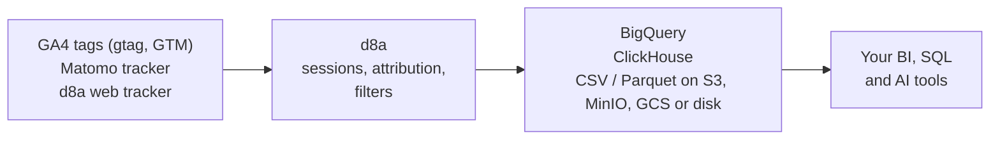
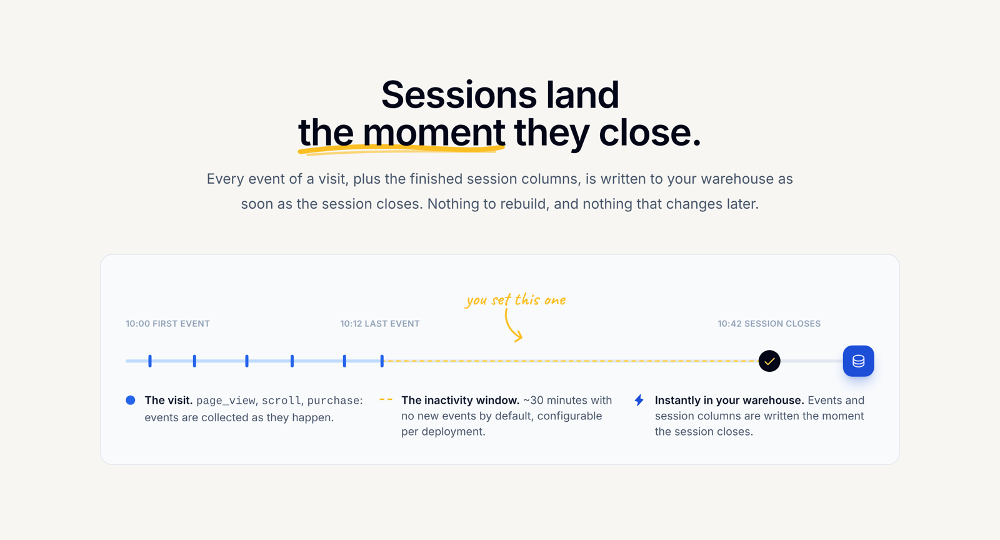
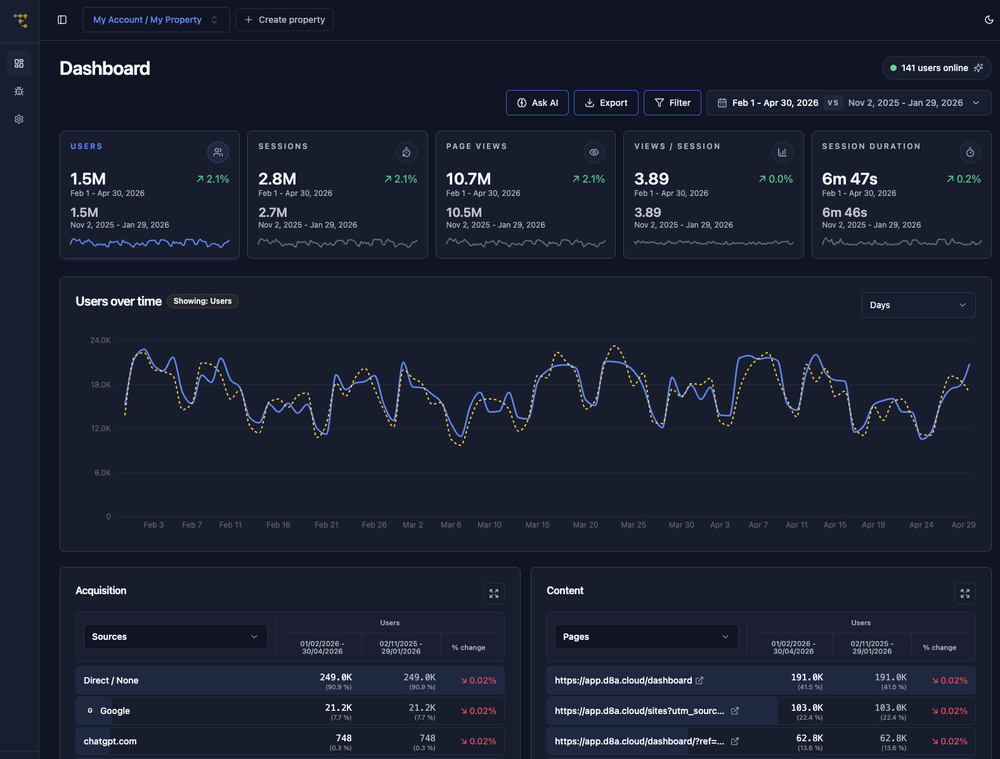
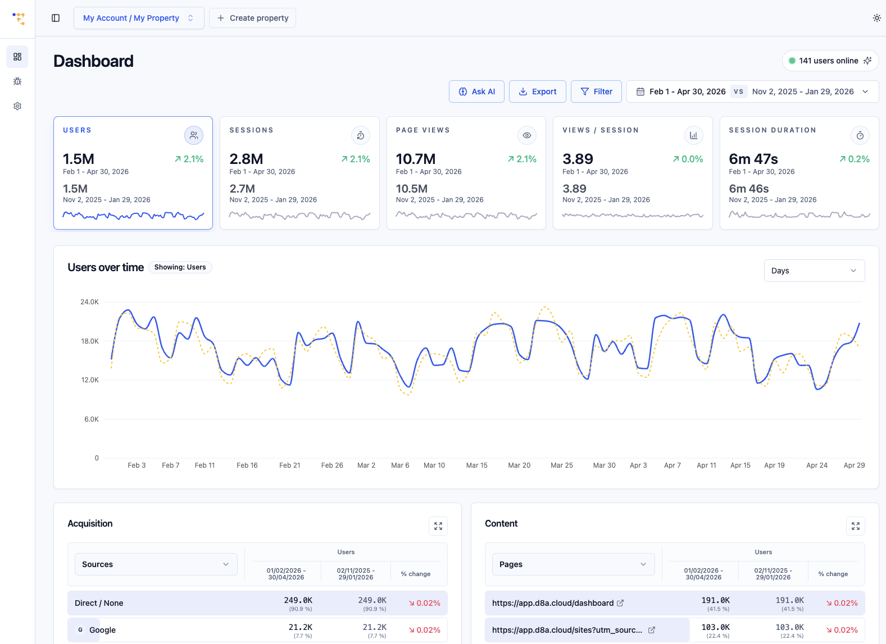
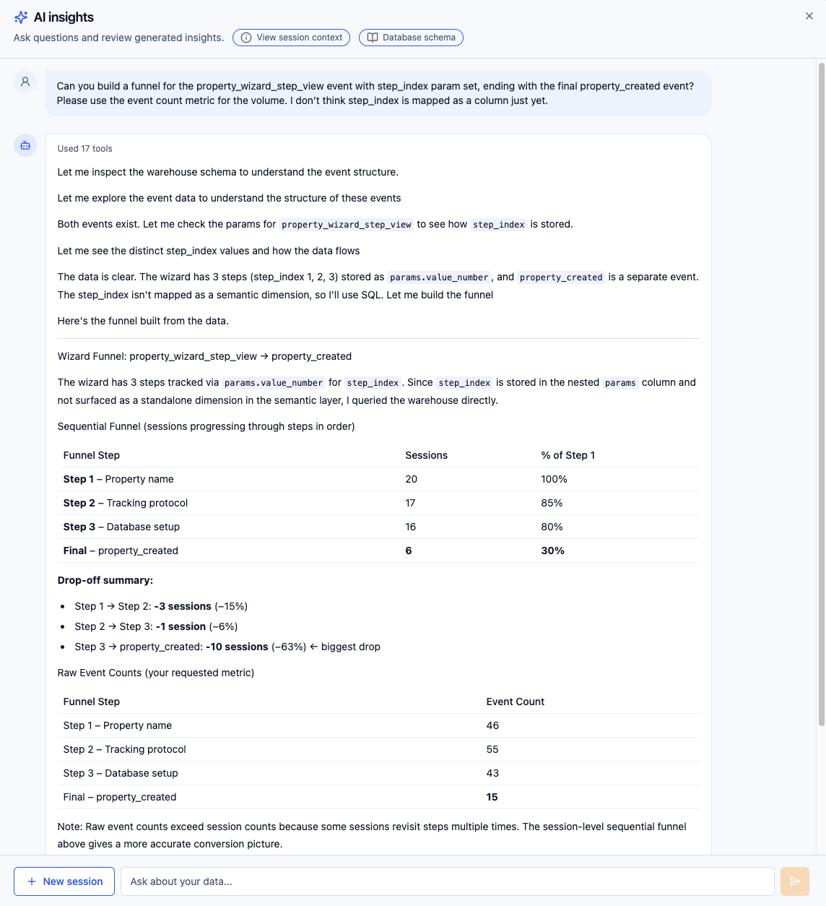
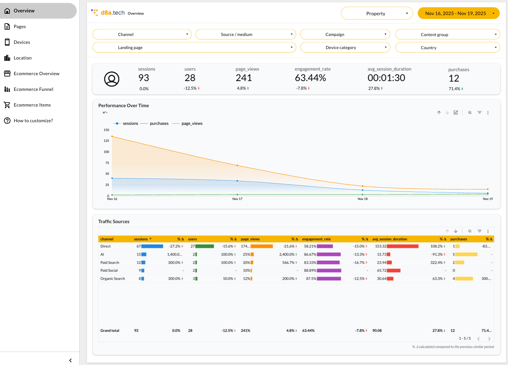
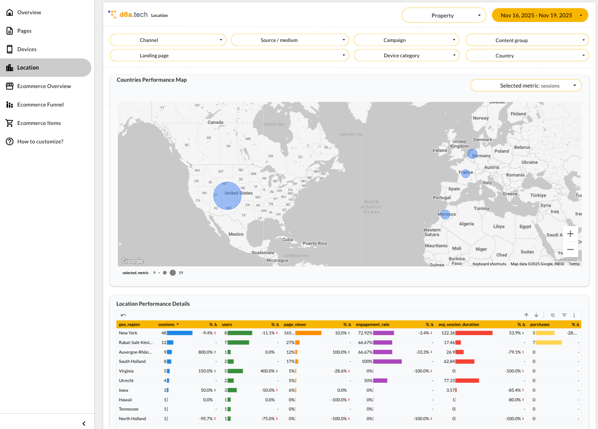
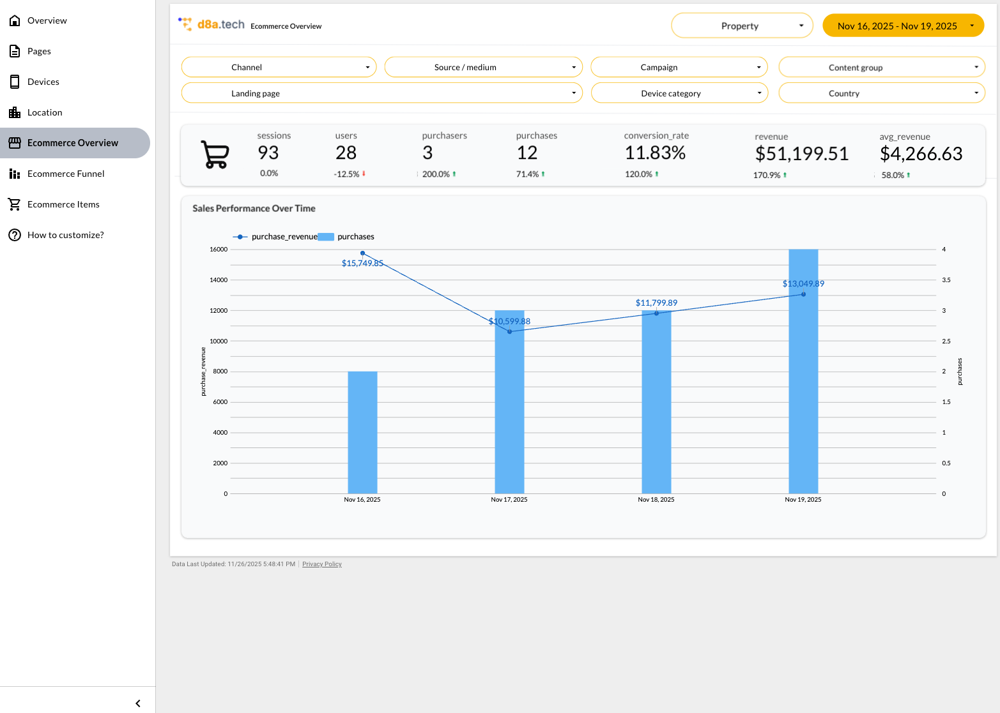

# d8a.tech: warehouse-native web analytics

[](LICENSE)
[](https://docs.d8a.tech/getting-started)
[](https://discord.gg/EegbcdsWUc)
[](https://github.com/d8a-tech/d8a/issues)

d8a.tech (pronounced "data tech") is an open source, warehouse-native web analytics pipeline. It receives the GA4 and Matomo tracking protocols, or its own web tracker, builds sessions on the backend, and writes clean, flat tables to BigQuery, ClickHouse or CSV/Parquet files. Run it in your own infrastructure, air-gapped if you need to, or use [d8a.tech Cloud](https://app.d8a.tech).



## Highlights

- **Keep your tracking.** d8a speaks the GA4 and Matomo tracking protocols. Duplicate your GA4 requests to d8a and keep GA4 running, redirect them to d8a instead of Google, or switch to the d8a web tracker, a drop-in replacement for `gtag.js`.
- **Sessions built on the backend.** Hits are grouped into sessions server-side, with a configurable inactivity timeout (30 minutes by default) and split rules for campaign changes, user ID changes, maximum duration and maximum events. Each session, with all its events, is written to the warehouse the moment it closes.
- **A flat, documented schema.** Events and sessions land as flat columns, ready for reporting, with no `UNNEST`. Custom parameters can be mapped to their own columns. Every column carries its own documentation, and the [schema reference](https://docs.d8a.tech/articles/database-schema) is generated from it.
- **Raw signals included.** Click IDs (`gclid`, `gbraid`, `wbraid`, `dclid`, `srsltid`, `fbclid`, `msclkid`) get dedicated columns, and the full landing URL keeps any other click ID queryable. IP addresses can be stored in full or masked at one of four levels.
- **Attribution and filtering.** Source and medium are derived from click IDs, referrers (search, social, email, video and AI assistants) and UTM parameters. Expression-based [traffic filters](https://docs.d8a.tech/articles/traffic-filtering) exclude internal traffic or bots, with a test mode.
- **Your storage.** Write directly to Google BigQuery or ClickHouse, or to CSV or Parquet files on S3, MinIO, GCS or a local filesystem.
- **Deploy where your policy requires.** Run it on-premises or in your own cloud. The `--airgapped` flag disables built-in outbound integrations.
- **Open source.** MIT-licensed, transparent and auditable. Fork it, contribute, or self-host it.

## When Data Lands



Sessions are built on the backend. Once a visit has been inactive for the session timeout (30 minutes by default, configurable with `sessions.timeout`), the session closes and all of its events, plus the finished session columns, are written to your warehouse at once. Every row is final when it arrives.

## Who Uses It

d8a runs in production for healthcare and government organizations. For example, [GovAnalytics.nl](https://www.govanalytics.nl/en/), a whitelabel analytics platform for Dutch government organizations, is built on d8a.

Typical reasons teams choose it:

- **Healthcare.** Keep visitor data inside infrastructure you control. d8a.tech signs BAAs.
- **Public sector.** Self-hosted or air-gapped deployments, with code your auditors can read.
- **Data teams and ecommerce.** Sessionized, flat tables in your own warehouse, instead of rebuilding sessions from GA4's nested BigQuery export.

## Capacity

Receivers scale out; session processing runs on a single worker that scales vertically. The [production operations guide](https://docs.d8a.tech/articles/production-operations) documents roughly 7,000 requests per second (about 7 billion events a month) on a machine with 16 cores and 30 GB of RAM, and about 100 million events a month on 2 CPUs and 4 GB of RAM.

## Open Source and d8a.tech Cloud

This repository is the full collection and processing pipeline. It ships without a reporting UI: bring your own BI tool, or start from the [Looker Studio template](https://lookerstudio.google.com/reporting/0e4102b6-c38b-4f55-aa25-c1fe91d1c1e9/page/p_53ep5k8umd).

[d8a.tech Cloud](https://app.d8a.tech) runs the same pipeline in the EU and adds a built-in analytics dashboard with goals, funnels and custom reports, plus Ask AI. See [pricing](https://d8a.tech/pricing) for the free tiers, the support package and Enterprise options.

## Screenshots

### d8a.tech Cloud only

The built-in dashboard and Ask AI are part of [d8a.tech Cloud](https://app.d8a.tech). They are not included in this repository.

<table>
  <tr>
    <td>
      <a href="./docs/static/img/cloud-dashboard-dark.png" target="_blank">
        
      </a>
    </td>
    <td>
      <a href="./docs/static/img/cloud-dashboard-light.png" target="_blank">
        
      </a>
    </td>
    <td>
      <a href="./docs/static/img/cloud-ask-ai-funnel.png" target="_blank">
        
      </a>
    </td>
  </tr>
  <tr>
    <td style="text-align:center;">Dashboard (Cloud only)</td>
    <td style="text-align:center;">Dashboard, light mode (Cloud only)</td>
    <td style="text-align:center;">Ask AI (Cloud only)</td>
  </tr>
</table>

### Open source, with your BI tool

These reports are built on d8a data in Looker Studio, using the [Looker Studio template](https://lookerstudio.google.com/reporting/0e4102b6-c38b-4f55-aa25-c1fe91d1c1e9/page/p_53ep5k8umd).

<table>
  <tr>
    <td>
      <a href="./docs/static/img/reporting-overview.png" target="_blank">
        
      </a>
    </td>
    <td>
      <a href="./docs/static/img/reporting-location.png" target="_blank">
        
      </a>
    </td>
    <td>
      <a href="./docs/static/img/reporting-ecommerce.png" target="_blank">
        
      </a>
    </td>
  </tr>
  <tr>
    <td style="text-align:center;">Overview</td>
    <td style="text-align:center;">Location</td>
    <td style="text-align:center;">Ecommerce</td>
  </tr>
</table>

## Running d8a

### Cloud

Start for free at [app.d8a.tech](https://app.d8a.tech/).

### Production setup (Docker)

See the [Getting started guide](https://docs.d8a.tech/getting-started) and the [production operations guide](https://docs.d8a.tech/articles/production-operations).

### Local development (from source)

1. Run it.

```bash
go run main.go server --config config.dev.yaml
```

2. Send a request and wait about 10 seconds for the session to close (the dev config uses a short session timeout).

```bash
curl "http://localhost:8080/g/collect?v=2&tid=14&dl=https%3A%2F%2Ffoo.bar&en=page_view&cid=ag9" -X POST
```

3. Check the console output to verify events are being processed.

## Testing

```bash
go test ./...
```

## Documentation

- [Getting started](https://docs.d8a.tech/getting-started)
- [Database schema and columns](https://docs.d8a.tech/articles/database-schema)
- [Traffic attribution](https://docs.d8a.tech/articles/traffic-attribution)
- [Technical deep dive](https://docs.d8a.tech/articles/technical-deep-dive)
- [Glossary of analytics terms](https://d8a.tech/glossary/)

## AI Usage Disclaimer

This work is developed with AI assistance, by professional software engineers with more than 10 years of experience in data/analytics space. Every line of code is manually reviewed before it's merged. Vibe-coded PRs made without understanding of the system will be declined.

## Contributing

We welcome contributions from the community. Bug fixes and targeted improvements are always appreciated. For larger refactors or architectural changes, we ask that you discuss your ideas with us on Discord or GitHub Issues first. While modern AI tools make it easy to generate extensive code changes, we need to carefully balance the needs of our community and maintain the project's direction.

You may notice some abstractions in the codebase that seem unnecessary. These exist to support our cloud service, which uses alternative implementations in certain areas.

Please ensure contributions are thoughtful and align with our project standards. PRs that appear to be purely AI-generated without human review and consideration may not be accepted. We value quality over quantity and appreciate the time you take to understand our codebase before contributing.

## Community

- [Discord](https://discord.gg/EegbcdsWUc)
- [Website](https://d8a.tech)
- [Talk to us](https://d8a.tech/contact) about deployments, support or partnerships

## License

MIT. See `LICENSE` for details.
